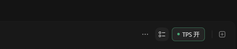
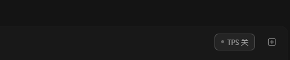

# 验证记录 · 0.3.0 · 2026-10-11

目标：Windows / macOS Codex 内嵌开关与每轮 TPS；使用日常启动入口时自动加载，开关不遮挡「新建标签页」。

- 41 项 Python 测试通过：统计口径、任务隔离、CDP、后台重启等待、Windows 激活与窗口复用、真实 Windows 快捷方式备份/更新/恢复、Mac 启动参数和 Finder 启动器、关闭后暂停读取日志。
- 13 项 JavaScript 身份和回复定位检查通过。
- 10 个 DOM 集成场景通过，覆盖开关、偏好记忆、历史均值、回复匹配及缺少原生工具栏时不覆盖标题层。
- PowerShell 及 Bash 语法检查通过；中文 PowerShell 脚本保留 UTF-8 BOM。
- Windows 已通过安装器升级为 0.3.0。安装前先等待旧后台退出，解决其工作目录被占用导致的缓存更新失败；13 个插件文件与安装缓存的 SHA-256 全部一致。
- 桌面和用户开始菜单已建立 Codex.lnk，并保留 Codex TPS 兼容入口。实际调用桌面 Codex 快捷方式后，原 TPS 主进程、CDP 页面和端口均被复用，没有增加持久主进程。

原生客户端为 26.1007.2314.0，CLI 为 0.162.0-alpha.17.2。验证没有关闭用户的 Codex 窗口。客户端完全退出后的恢复路径由模拟无连接、后台已退出的测试覆盖。

## 实际工具栏与开关

overlay v8 将按钮放到原生末尾工具栏、位于新建标签页左侧，参与布局测量。实际 Windows 页面在 1563、800、620 像素宽度下，两个按钮的矩形都不相交；各自中心的 elementFromPoint 均命中正确按钮。临时 viewport 覆盖已清除。

开启时实际渲染 4 条状态行，关闭后为 0，按钮继续显示。验证结束恢复了用户原先的开启状态。几何和开关记录见 [windows-layout.json](validation/windows-layout.json)。

开启：

关闭：

## 自动加载范围

Windows 从安装器建立的桌面或开始菜单 Codex 入口打开，会同时启动客户端和 TPS 后台，无需每个对话调用技能。开关偏好会保留。没有注册登录观察器；原 Store 入口和已有任务栏固定图标不会被透明接管。

Mac 从 ~/Applications/Codex TPS.app 启动，可放入 Dock。原 Codex.app 入口不会被替换。应用路径、shell 引用、自定义 CODEX_HOME、后台独立会话和现有窗口复用已通过模拟测试。**当前只有 Windows 环境，Mac 真机启动和布局尚未验证。**

此扩展依赖本机渲染连接及页面结构，不属于官方原生状态栏 API。没有修改客户端安装包；测试未调用模型 API、读取认证信息或上传聊天内容。
